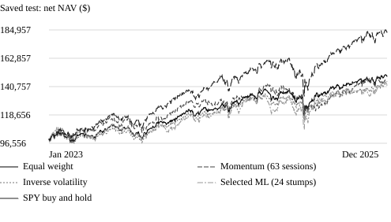
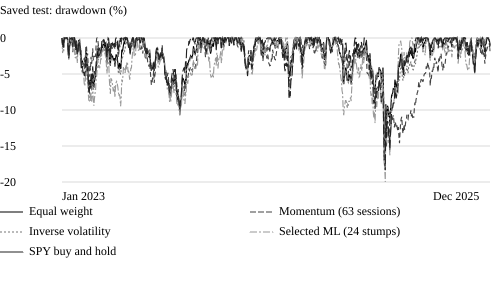

# Does bounded ML improve sector ETF allocation?

thvh2006 · 25 November 2026

## Abstract
A bounded six-candidate learning study compares monthly allocation among nine US sector ETFs with simple baselines. Using a saved development choice and a 2023–2025 test, the selected 24-stump model earns 12.41% CAGR after assumed costs, below momentum (13.19%) and equal-weight (14.16%). Its average paired monthly difference versus momentum is negative and its block-bootstrap interval includes zero. A further-session fill delay reverses rankings, underscoring implementation sensitivity. The retrospective result does not support trading promotion. Frozen hashes, self-financing accounting and independent review examples support reproducibility; corrected source data, fixed-fund selection, idealised execution and limited observations restrict inference.

## 1. Research question and decision

This study asks whether a bounded machine-learning ranking model improves monthly allocation among nine US sector ETFs after assumed execution costs. The investment decision is incremental: an elaborate model must offer evidence beyond a simple allocation rule. Positive absolute returns during an equity rally do not meet that standard. The working null is that the selected ML policy provides no reliable improvement over momentum. Equal-weight, inverse-volatility and SPY buy-and-hold provide additional economic context.

The saved evaluation answers the question negatively within this specification and sample. The selected boosted-stump policy earns a 12.41% annualised net compound return in 2023–2025, compared with 13.19% for momentum, 14.16% for equal-weight and 22.39% for SPY. Its maximum drawdown is also deeper than the sector baselines. A paired monthly uncertainty interval includes zero. The appropriate decision is to retain the research evidence and withhold trading promotion.

The unit of economic evaluation is a dated portfolio decision. Nine correlated fund observations do not create nine independent investment experiments each month. The 36 test months are a short sample, particularly for regime analysis. The study is therefore an exploratory, retrospective portfolio case rather than an institutional alpha claim. Completing a reproducible negative result is a valid outcome; model complexity is not a success metric.

## 2. Economic hypothesis and literature boundaries

The economic hypothesis is that recent relative returns, realised risk and trading activity may contain information useful for ranking sector funds. A nonlinear learner could condition a momentum signal on volatility or drawdown, while regularisation could reduce unstable fitted coefficients. The contrary argument is substantial: sector funds share equity-market risk, the cross-section is small, the features are highly related, and a noisy forecast can generate costly switches without improving the holdings selected.

Gu, Kelly and Xiu (2020) compare machine-learning methods in a broad empirical asset-pricing setting and discuss nonlinear predictive interactions [S1]. That provides motivation for a bounded comparison here. This study does not replicate their data, architecture, investment universe or economic result. Its five technical features and nine fund wrappers cannot establish a claim about ML across the stock market. The industry-momentum literature is relevant background, but a 63-session fund rule is a distinct choice from the intermediate-horizon stock strategies discussed by Moskowitz and Grinblatt (1999) [S2].

Bailey et al. (2015) motivate concern about selection across investment backtests [S3]. Limiting candidates and saving a test result constrains discretion, but this project does not implement their CSCV procedure or estimate PBO. Trading-cost research also motivates explicit implementation analysis; Frazzini, Israel and Moskowitz (2018) study costs that vary with conditions [S4]. The numerical cost assumptions here are analyst scenarios, not estimates calibrated from their institutional trades. These references guide questions and limits rather than supply evidence that this strategy should succeed.

## 3. Data, universe and provenance

The fixed universe is XLB, XLE, XLF, XLI, XLK, XLP, XLU, XLV and XLY, with SPY as the market benchmark. The normalised input covers 3 January 2017 through 31 December 2025: 2,262 sessions and 22,620 asset-session records. The source receipt reports a complete rectangular panel with no missing asset-session cells. Completeness in this selected set is not proof of a survivorship-free universe. The study follows fund wrappers whose sector membership and classification may change.

Historical tables captured from Yahoo Finance supply opening and closing marks, displayed volume and event markers. The issuer distribution workbook supplies cash amounts and payable dates. The captured prices are rounded and retrospectively corrected; there is no historical provider-vintage archive. A private normalised snapshot and source bytes have recorded SHA-256 digests. The release verifier checks consistency with those receipts, but a hash cannot demonstrate that a provider observation was economically correct or available historically in its present form.

The 2017 starting point avoids treating the documented 2016 XLF distribution of XLRE as a simple ordinary share split. This is a data-handling scope decision disclosed in the protocol, not a search for the most attractive performance window. It also reduces the historical span. Raw third-party records remain outside the published repository because redistribution rights have not been established. Public outputs contain original code, generated fixtures, narrow review inputs and derived research results; they do not convey a provider license.

## 4. Corporate actions, calendar and units

Prices and share quantities must use consistent historical units. The intake script reconstructs pre-split displayed prices for five funds by a factor of two before the 5 December 2025 2-for-1 actions. The issuer announcement identifies those actions and published contemporaneous prices [S5]. The retained receipt records five price comparisons. Display precision means reconstructed historical ticks can have two-cent increments. This reconstruction is useful validation, but does not certify every field of the history.

The ledger credits an existing holder with a receivable on the ex-date and moves that receivable into cash on the payable date. A buyer entering on the ex-date does not receive the old holder’s distribution. Splits change shares before trading and distribution processing. Raw prices plus separate action accounting drive NAV; an adjusted total-return price is not used as an execution mark and then credited with the same dividend again. The source receipt records 362 distribution comparisons and one resolved SPY discrepancy with issuer precedence.

Exchange sessions use an explicit NYSE-rule calendar with special mourning closures, checked against the observed SPY dates. A conservative 16:15 New York signal timestamp follows the regular close and early closes. Daylight-saving offsets are tested. Reported volume divided by the future split factor is a conservative capacity proxy whose original source basis remains independently unverified. Neither calendar agreement nor daily volume validates the liquidity actually available at an opening auction. These distinct confidence levels remain visible in the model card.

## 5. Information timeline and prediction target

The five features are trailing 21-session and 63-session distribution-inclusive wealth returns, a 20-session daily-return sample standard deviation, a 63-session drawdown and log trailing mean dollar volume. Feature values use observations only through the signal close. Risk and drawdown features describe the recent return path; liquidity is a rough activity measure rather than an order-book estimate. Fundamental or constituent data are deliberately absent because point-in-time availability was not established.

The supervised target starts at the next session’s opening mark and ends at the opening mark 21 sessions after entry. It includes applicable distributions and share actions over the holding interval. A sample is admitted to training only after its target is mature and after the configured additional session gap. Whole date groups stay together in the panel. Learned standardisation, tree cut points and coefficients are estimated from eligible training observations only. The target window is fixed even though the investment portfolio rebalances monthly; calendar-month and 21-session intervals are related but not identical.

The first test trade uses a signal dated 30 December 2022 and an intended fill on 3 January 2023. A prior-year signal is therefore legitimate for a new-year fill. Saved fit windows record the latest eligible label end, signal and fill for each monthly refit. Future-price perturbation tests challenge earlier feature and ridge-prediction invariance. This is a concrete leakage test, while the saved fit receipts provide traceability. Neither test resolves the separate limitation that the historical source dataset may have later revisions.

## 6. Models, selection and baseline fairness

Training begins in 2017 after the 63-session feature warm-up. Development fills fall in 2020–2022; test fills fall in 2023–2025. The six candidates are ridge with alpha 0.1, 10 and 100; elastic net with alpha 0.001 and 0.01 at a 0.5 L1 ratio; and 24 boosted decision stumps with learning rate 0.05. The stump model is an original small NumPy implementation, not XGBoost or LightGBM. Restricting the model family is a scope choice, not an assertion of equivalence to those libraries.

The fixed selection rule is highest development net daily Sharpe using zero cash return. Stumps rank first among ML candidates with development Sharpe about 0.462, yet momentum achieves about 0.646 and equal-weight about 0.523. Thus winning the ML comparison already fails to establish an allocation advantage. The complete trial register includes weaker models. Ridge 0.1 and ridge 10 produce the same selected holdings and portfolio metrics in development; distinct coefficients need not change a discrete top-three portfolio.

ML and momentum both allocate one third to each of three selected funds, with whole shares and residual cash. Equal-weight holds all nine sector funds; inverse-volatility uses normalised inverse risk with a 35% target cap. SPY is a costed buy-and-hold reference. All use the shared cash/action engine, fee convention and opening-mark assumption. Diversification differs across strategies by design, so comparisons combine forecast and portfolio-policy differences. The test evaluates only the development-selected ML policy, with permitted past-only monthly refits; other ML candidates are not selected using test performance.

## 7. Portfolio construction and execution accounting

Every simulation starts with $100,000 and no holdings. A signal generated after one session is eligible for the next session’s opening mark. The model assumes that portfolio targets can be sized at that mark, an idealised daily-bar execution convention. Orders sell before buying, expire after the session and respect cash, whole-share and prior-session-volume caps. No leverage, shorting, FX, borrowing or tax model is included. Residual cash earns zero. These choices make the accounting explicit but do not establish an executable market-on-open strategy.

The base case charges 1 bp commission on executed consideration and embeds 5 bp adverse slippage in the fill price, per side. Fees reduce cash once. Slippage is already in execution consideration, so its diagnostic total must not be deducted from NAV a second time. Fund expenses affect observed prices; subtracting the expense ratio again would likewise double count. A zero-cost scenario reruns the saved intended weights through the existing ledger, so sizing and subsequent holdings can change. A zero-cost final NAV minus a costed final NAV is therefore not merely the sum of reported fee and slippage totals.

Daily NAV equals cash plus closing market value plus unpaid distribution receivables. The expanded attribution independently allocates daily NAV changes across funds using changes in market value, new entitlements, recovery cash and executed trade cash flows including fees. Share splits conserve units without creating P&L. Every strategy-day reconciles to within floating-point tolerance. The Excel lab independently reconstructs the first cash rebalance and permits capital and cost changes. It is an economic audit sample, not an independent full reimplementation of the ML training pipeline.

## 8. Saved test results and economic interpretation

The saved test includes 752 sessions and 36 calendar months. Returns use end-of-day marked NAV relative to the previous NAV, including entry execution costs on the first day. CAGR uses 252 trading sessions per year; annual volatility and the zero-cash Sharpe use daily return moments. Sharpe here is not excess return over a Treasury bill series. Maximum drawdown includes the original $100,000 starting point. Equal initial capital and shared dates make the NAV paths directly comparable.

The selected ML policy finishes at $141,788.84, while momentum finishes at $144,751.18 and equal-weight at $148,455.13. ML volatility is 16.66%, its zero-cash Sharpe is 0.785 and its maximum drawdown is 19.94%. Those figures are weaker than momentum’s Sharpe of 0.936 and 16.63% drawdown, and weaker than equal-weight’s Sharpe of 1.088 and 15.59% drawdown. Positive ML returns therefore coexist with negative incremental evidence. SPY’s higher 22.39% CAGR also shows that the rotation policies did not capture all of the broad equity-market opportunity in this interval.

This comparison supports a limited rejection of model promotion, not proof that machine learning can never help sector allocation. A different economic question, source dataset, feature family or execution rule would be a new study requiring its own design and evaluation budget. The present result must remain visible rather than be replaced by another search until a chart improves. Reported performance is hypothetical retrospective accounting. It cannot be described as an investor’s realised return or a prospective paper record.

Table 1. Saved primary test performance.

| Strategy | CAGR | Volatility | Sharpe* | Max DD | Final NAV |
| --- | --- | --- | --- | --- | --- |
| Equal weight | 14.16% | 12.93% | 1.09 | -15.59% | $148,455 |
| Momentum | 13.19% | 14.35% | 0.94 | -16.63% | $144,751 |
| Inverse volatility | 12.37% | 12.36% | 1.01 | -15.30% | $141,642 |
| Selected ML | 12.41% | 16.66% | 0.79 | -19.94% | $141,789 |
| SPY buy and hold | 22.39% | 15.05% | 1.42 | -18.31% | $182,758 |

Note: Sharpe uses zero cash yield. All values are hypothetical and include assumed trading costs.

## 9. Diagnostics, exposure and P&L attribution

The selected model’s mean cross-sectional rank IC over 36 saved eligible monthly diagnostic dates is -0.0271, with sample standard deviation 0.4102. Positive IC occurs on 44.4% of these dates. The mean-to-standard-deviation ratio is reported without annualisation because the forward labels can overlap and the sample is short. A pooled correlation of all fund rows would obscure date dependence. Prediction diagnostics are read after evaluation and do not change the selected model.

The ML return beta relative to the costed SPY path is 0.911, while mean gross equity exposure is 99.83%. Beta is a descriptive covariance ratio, not a factor-model alpha estimate or a causal exposure. Dollar attribution shows where marked profits and losses came from after trade costs. It does not separate security-selection skill from sector drift, market beta or timing effects. Daily market weights can exceed the 35% target limit between monthly rebalances because prices move; the cap is enforced on the stated target construction, not continuously.

The report also presents calendar-year returns, full drawdown paths and mean fund weights. These are descriptive breakdowns of the same saved test, not additional independent tests. Saved stump split counts illustrate which features the fitted models used but are not causal feature importance. No post-test feature ablation, leave-sector-out search or retuning was performed. Such experiments would require a separately labelled development study. The distinction prevents a seemingly richer appendix from silently becoming another test-selection loop.

## 9.1. Post-study explanation of the comparative shortfall

The following decomposition was added after the historical test had been consumed. It describes saved results without changing candidate selection, the policy, the execution rule or the evaluation sample. Every comparison starts with the same $100,000. The zero-cost final-NAV gap plus the differential friction effect equals the costed final-NAV gap. Friction here includes the effect of altered whole-share sizing and compounding; it is not simply the difference between reported fees.

Against momentum, ML trails by $3,045.28 in the archived zero-cost rerun. Differential friction offsets $82.93 of this gap, leaving a $2,962.35 costed shortfall. Thus additional trading costs alone do not explain the primary failure: the shortfall was already present in the zero-cost allocation outcomes. Against equal weight, the zero-cost shortfall is $4,359.58 and differential friction adds a further $2,306.72 disadvantage, producing a $6,666.30 net gap. The importance of friction depends on the comparator.

Fund-level net contribution differences reconcile these gaps. Relative to momentum, XLK contributes about $15,134 less and XLF about $6,370 less, while XLE contributes about $16,365 more. These terms combine different holdings, timing and execution; they are neither a Brinson decomposition nor isolated causal stock-selection effects. ML finishes with 2.05% less wealth than momentum and 4.49% less than equal weight. Winning 20 of 36 individual months against equal weight still does not imply higher terminal compounded wealth. All these views describe the same test and provide no new independent confirmation.

## 10. Cost and execution-delay challenges

At zero cost the ML CAGR is 13.07%, compared with 13.87% for momentum and 14.20% for equal-weight. At twice base fees and slippage, ML falls to 11.77%; at three times base it falls to 11.11%. Momentum remains ahead in these corresponding cost scenarios. Equal-weight changes much less because it trades less. The selected ML policy’s annualised one-way turnover is approximately 4.85, compared with 5.01 for momentum and 0.32 for equal-weight. Turnover is one half of daily traded raw notional divided by NAV, summed and annualised by session count.

The predeclared additional-session delay produces ML CAGR of 15.83%, momentum 11.54% and equal-weight 14.47%. This reversal is material. It means a modest implementation-timing change can alter comparative rankings in the observed sample. It does not justify switching the production rule to delayed ML after looking at the test. The primary rule remains the originally specified next-session convention. The delayed result is an implementation fragility diagnostic and a hypothesis for a future, separately evaluated study.

Daily capacity limits use prior-session volume, avoiding reliance on the unknown final volume of the fill session. Nevertheless, a daily total is not an opening-auction liquidity estimate, and an assumed spread plus slippage is not empirical market impact. Small simulated capital and the absence of binding orders do not certify scalability. Capacity should therefore be interpreted as a conservative bookkeeping scenario. Historical intraday auction data, spread observations and broker calibration are prerequisites for a stronger implementation claim.

## 11. Uncertainty, selection risk and limitations

The primary paired statistic is the arithmetic mean of ML minus momentum calendar-month net returns. It equals -0.0315 percentage points per month. A circular three-month block bootstrap with 2,000 resamples and seed 20261124 yields a 95% interval of [-0.9999, 0.9886] percentage points per month. Blocks preserve some short-range time dependence instead of treating every month as independently exchangeable. The interval contains zero and is economically wide.

This interval is descriptive small-sample uncertainty, not a probability that ML will outperform next year. It is not a confidence interval for CAGR, and the difference of two CAGRs is not the mean paired monthly difference. The bootstrap does not adjust for all historical research choices, selected funds, model-family decisions or repeated study design. Neither the local hash freeze nor a saved test cures these limitations. The freeze receipt documents the stored specification and selected candidate; it is not an external preregistration with independent time attestation.

Additional limits include corrected rather than vintage data; a fixed fund universe; changing sector classifications; rounded marks; volume-basis uncertainty; idealised opening sizing; short test length; absent tax, financing and nonzero cash yield; and the absence of live execution evidence. Technical tests establish internal economic consistency within their cases. They cannot certify provider accuracy, causality, institution-level governance or profitability. These limits constrain the decision to a research release and rule out treating the outputs as a current trading recommendation.

## 12. Forward operations and final decision

The saved snapshot ends on 31 December 2025. At the release date, 25 November 2026, the staleness monitor therefore blocks a current signal. It reports zero published forward signals and zero realised forward sessions. Its append-only status records do not create a live market feed. A prospective process must receive a permitted fresh snapshot, validate sources and sessions, freeze an approved strategy version, timestamp forecasts before outcomes and reconcile subsequent paper fills. It must log incidents rather than backfill an attractive prospective history.

The repository includes an operational checklist, source-access guide, code, generated engineering fixture, saved development and test outputs, derived diagnostics, an executed notebook sequence, a spreadsheet review and an interactive snapshot explorer. Public verification intentionally works without redistributing raw provider records. Reproducing the original training requires separately obtaining the private inputs under appropriate permissions and following the documented normalisation contract. Refreshing the historical source would create a new dataset version rather than overwrite this saved study.

The final research decision is no promotion of the selected ML policy. The primary specification fails to establish incremental value after costs, prediction IC is weak, drawdown is worse than the main baselines, and delay sensitivity shows material timing dependence. The work still demonstrates data/action engineering, time-ordered model comparison, portfolio accounting and transparent interpretation of an unfavourable result. Future extensions remain new research tasks rather than missing positive findings. The completed retrospective release should be judged by the clarity and reproducibility of that evidence.

## Appendix A. Saved NAV and drawdown

## References

- [S1] Gu, S., Kelly, B. and Xiu, D. (2020). Empirical Asset Pricing via Machine Learning. Review of Financial Studies 33(5), 2223–2273. [Source](https://doi.org/10.1093/rfs/hhaa009)
- [S2] Moskowitz, T. J. and Grinblatt, M. (1999). Do Industries Explain Momentum? Journal of Finance 54(4), 1249–1290. [Source](https://www.aqr.com/insights/research/journal-article/do-industries-explain-momentum)
- [S3] Bailey, D. H., Borwein, J. M., Lopez de Prado, M. and Zhu, Q. J. (2015). The Probability of Backtest Overfitting. [Source](https://www.davidhbailey.com/dhbpapers/backtest-prob.pdf)
- [S4] Frazzini, A., Israel, R. and Moskowitz, T. J. (2018). Trading Costs. [Source](https://www.aqr.com/Insights/Research/Working-Paper/Trading-Costs)
- [S5] State Street (20 November 2025). Share splits for five Select Sector SPDR ETFs. [Source](https://investors.statestreet.com/investor-news-events/press-releases/news-details/2025/State-Street-Investment-Management-Announces-Share-Splits-for-Five-Select-Sector-SPDR-ETFs/default.aspx)
- [S6] State Street. Historical ETF distributions, ex-dates and payable dates. Private downloaded workbook hash in market_receipt.json. [Source](https://www.ssga.com/us/en/individual/resources/documents/etf-dividend-distributions)
- [S7] Yahoo Finance. Historical data tables. Private capture receipt; example XLK page. [Source](https://finance.yahoo.com/quote/XLK/history/)
